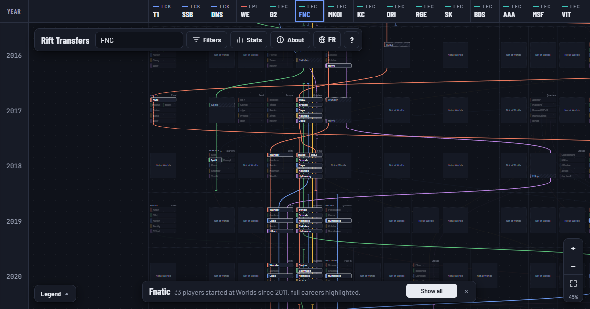

# Rift Transfers

Interactive map of the rosters of **every** team that played the League of Legends **World Championship, 2011 → 2026**. Each team is a column, each Worlds a row, and each player a thread coloured by role: follow a career from one team to the next, or a team's life down its column.

**[Open the map](https://mrpa2a.github.io/rift-transfers/map/)** — in English or French.



## Features

- Full-screen map: drag with the mouse or a finger, zoom with the wheel or a pinch.
- **Every team that played at least one Worlds**: 120 columns, 14 regions, 2011 to 2026. The map opens on the whole period and every column; the "Worlds appearances" filter thins it out in one click — 54 columns from two appearances, 33 from three, 19 from five.
- Hover or click a player to light up their whole career; click a team to see its players, or only its arrivals and departures — columns with no exchange with it are greyed out.
- **Isolate**: click a year to keep only that edition's teams and the ones its players came from or went to; the Isolate button keeps only the columns a selection passed through, packed side by side.
- Search players and teams alike, by handle, code or full name; `?q=` opens the map with one already selected.
- Filters by role, region, period and number of Worlds appearances, and columns hidden one by one (the header's `×` or the drawer's checklist). With a region or team hidden, its players go through the "Other teams" column, so transfers stay traceable.
- Options: nationality (with imported players marked) and tenure with the team.
- Each team's result at each edition, and statistics (most present players, unchanged rosters, flows between regions, imports).
- A guided tour on the first visit, replayable with `?`; an About panel to report a display bug or a data error, pre-filled with what you are looking at.

## The data

A row shows **the players who played that Worlds for the team**, not the season's roster. A player is kept at a role if they played at least 20% of the team's games there; when two players clear that bar, the slot splits into two half-slots, each linked to its own career.

All the data lives in [`data/`](data/) as JSON, with its sources:

| File | Content |
|---|---|
| [`teams.json`](data/teams.json) | Teams and starters for each edition |
| [`results.json`](data/results.json) | Each team's result |
| [`players.json`](data/players.json) | Verified nationalities |
| [`careers.json`](data/careers.json) | Where each player was in the years without Worlds |
| [`sources.json`](data/sources.json) | Sources, year by year |

Nothing is typed in from memory: every lineup is derived from a single source, Leaguepedia's game records, by written selection rules. The method is described in [docs/SOURCES.md](docs/SOURCES.md) (in French, with an English summary at the top), and the collection is automated by [`scripts/fetch-worlds.mjs`](scripts/fetch-worlds.mjs).

## Running it locally

Requires Node.js 18 or later. Nothing to install.

```bash
npm run dev        # http://localhost:5173 — the root redirects to /map/
npm run validate   # checks the data's consistency
```

The site has to be served by a web server: opening `map/index.html` straight from disk cannot load the JSON files.

## Structure

```
index.html              # root: redirects to /map/
map/index.html          # the map
assets/css/styles.css   # styles (light and dark themes)
assets/js/app.js        # data loading and map rendering
assets/js/i18n.js       # French / English dictionary of the interface
assets/js/tour.js       # guided tour
assets/js/report.js     # GitHub issues pre-filled from the map
data/                   # JSON data and sources
docs/SOURCES.md         # method and sources
scripts/serve.mjs       # dependency-free development server
scripts/validate-data.mjs   # data consistency
scripts/fetch-worlds.mjs    # collects the starters from Leaguepedia
```

## Contributing

A mistake in a roster? Open an issue with a source, or propose the fix directly: see [CONTRIBUTING.md](CONTRIBUTING.md).

## Privacy

Visits are counted with Cloudflare Web Analytics: no cookies, no personal data. It is the site's only third-party call, and the map works the same without it.

## Licence

Code under the [MIT](LICENSE) licence. The data is compiled from the sources cited in [docs/SOURCES.md](docs/SOURCES.md), which keep their own licences (Leaguepedia and Liquipedia: CC BY-SA 3.0).

Fan project, not affiliated with Riot Games. League of Legends is a trademark of Riot Games, Inc.
