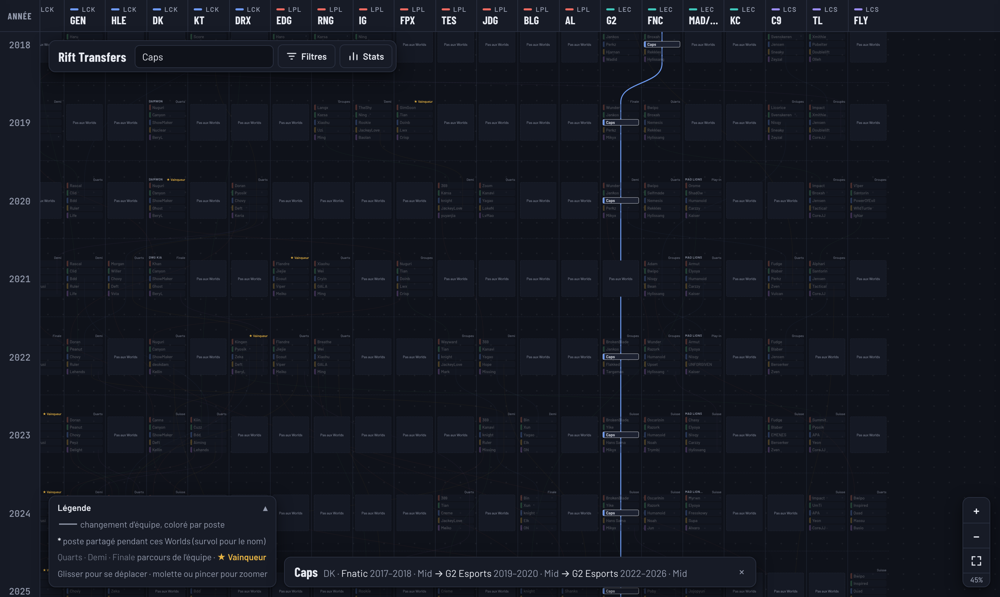

# Rift Transfers

Carte interactive des rosters des grandes équipes de League of Legends aux **Worlds 2011 → 2026**. Chaque équipe est une colonne, chaque édition des Worlds une rangée, et chaque joueur un fil coloré par poste : on suit sa carrière d'une équipe à l'autre, ou la vie d'une équipe en descendant sa colonne.



## Fonctionnalités

- Carte plein écran : déplacement à la souris ou au doigt, zoom à la molette ou au pincement.
- **Toutes les équipes ayant joué au moins un Worlds** : 120 colonnes, 14 régions, 2011 à 2026. La carte s'ouvre sur 2013 → 2026 et sur la totalité des colonnes ; le filtre « Présence aux Worlds » la dégrossit d'un clic — 54 colonnes à partir de deux apparitions, 33 à partir de trois, 19 à partir de cinq.
- Survol ou clic sur un joueur pour isoler toute sa carrière ; clic sur une équipe pour voir ses joueurs, ou seulement ses arrivées et départs — les colonnes sans échange avec elle sont grisées.
- Filtres par poste, par région, par période et par nombre d'apparitions aux Worlds, et masquage des colonnes une à une (`×` de l'en-tête ou liste à cocher du tiroir). Région ou équipe masquée, ses joueurs passent par la colonne « Autres équipes » pour garder la trace des transferts.
- Options : nationalité (avec repérage des joueurs importés) et ancienneté dans l'équipe.
- Parcours de chaque équipe à chaque édition, et statistiques (joueurs les plus présents, rosters stables, flux entre régions, imports).

## Les données

Une rangée montre **les joueurs qui ont joué les Worlds pour l'équipe**, et non le roster de la saison. Un joueur est retenu à un poste s'il y a joué au moins 20 % des parties de l'équipe ; quand deux joueurs franchissent ce seuil, la case se partage en deux demi-cases, chacune reliée à sa propre carrière.

Toutes les données sont dans [`data/`](data/) au format JSON, avec leurs sources :

| Fichier | Contenu |
|---|---|
| [`teams.json`](data/teams.json) | Équipes et titulaires par édition |
| [`results.json`](data/results.json) | Parcours de chaque équipe |
| [`players.json`](data/players.json) | Nationalités vérifiées |
| [`sources.json`](data/sources.json) | Sources année par année |

La méthode de vérification (nombre de matchs joués par joueur, matchs joués ensemble…) est décrite dans [docs/SOURCES.md](docs/SOURCES.md). La collecte depuis Leaguepedia est automatisée par [`scripts/fetch-worlds.mjs`](scripts/fetch-worlds.mjs).

## Lancer le projet en local

Prérequis : Node.js 18 ou plus. Aucune dépendance à installer.

```bash
npm run dev        # http://localhost:5173
npm run validate   # vérifie la cohérence des données
```

Le site doit être servi par un serveur web : ouvrir `index.html` directement depuis le disque ne permet pas de charger les fichiers JSON.

## Structure

```
index.html              # page unique
assets/css/styles.css   # styles (thème clair et sombre)
assets/js/app.js        # chargement des données et rendu de la carte
data/                   # données JSON et sources
docs/SOURCES.md         # méthode et sources
scripts/serve.mjs       # serveur de développement sans dépendance
scripts/validate-data.mjs   # cohérence des données
scripts/fetch-worlds.mjs    # collecte des titulaires depuis Leaguepedia
```

## Contribuer

Une erreur dans un roster ? Ouvrez une issue avec une source, ou proposez directement la correction : voir [CONTRIBUTING.md](CONTRIBUTING.md).

## Licence

Code sous licence [MIT](LICENSE). Les données sont compilées à partir des sources citées dans [docs/SOURCES.md](docs/SOURCES.md), qui gardent leurs propres licences (Leaguepedia et Liquipedia : CC BY-SA 3.0).

Projet de fan, non affilié à Riot Games. League of Legends est une marque de Riot Games, Inc.
